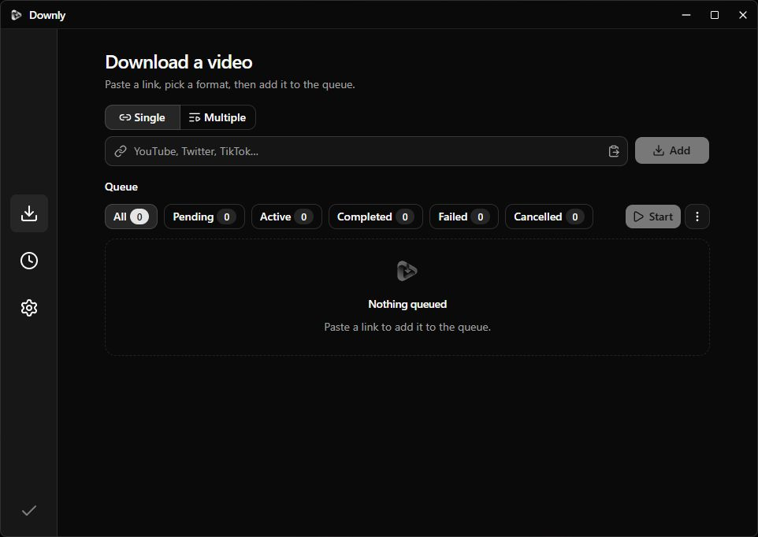

# Downly

Windows desktop downloader for YouTube, X, Streamable, Twitch, Vimeo, TikTok, Reddit, SoundCloud, and other sites yt-dlp supports. Paste a link, pick a format, queue the download.

Built with Tauri 2, React, TypeScript, and shadcn/ui. Bundled tools are yt-dlp (Unlicense) and FFmpeg (GPL).



> [!NOTE]
> The Windows installer is not code-signed. SmartScreen may warn on first open. Use More info → Run anyway.

## Features

- Look up one link and pick a raw yt-dlp format, or paste several links with a shared quality preset
- Playlist dialog for a single playlist URL (this video or the whole list)
- One active download at a time with Start / Stop
- History that keeps finished and failed jobs without deleting files
- English and Turkish UI, system / light / dark theme
- Manual yt-dlp update with SHA-256 verification

## Install

Download the latest Windows installer from [Releases](../../releases). Prefer the user install; no admin prompt.

## Build from source

### Prerequisites

- [Node.js](https://nodejs.org/) and [pnpm](https://pnpm.io/)
- [Rust](https://www.rust-lang.org/)
- [Tauri prerequisites](https://v2.tauri.app/start/prerequisites/) for Windows

### Steps

```bash
pnpm install
powershell -ExecutionPolicy Bypass -File scripts/fetch-binaries.ps1
pnpm tauri dev
```

Production build:

```bash
pnpm tauri build
```

`scripts/fetch-binaries.ps1` downloads official `yt-dlp.exe` and a BtbN GPL FFmpeg build into `src-tauri/resources`. Those binaries are not committed.

## Stack

- Frontend: Vite, React, TypeScript, Tailwind, shadcn/ui
- Backend: Tauri 2, Rust
- Package manager: pnpm
